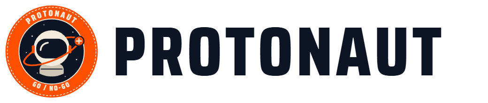
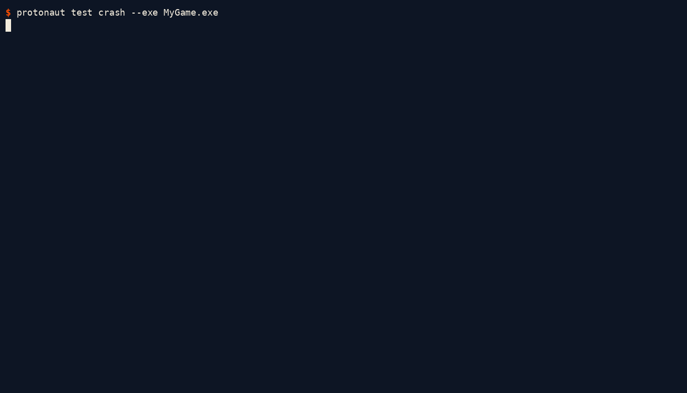
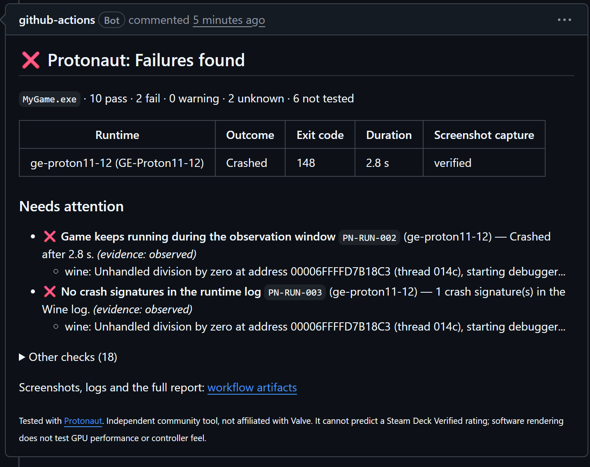
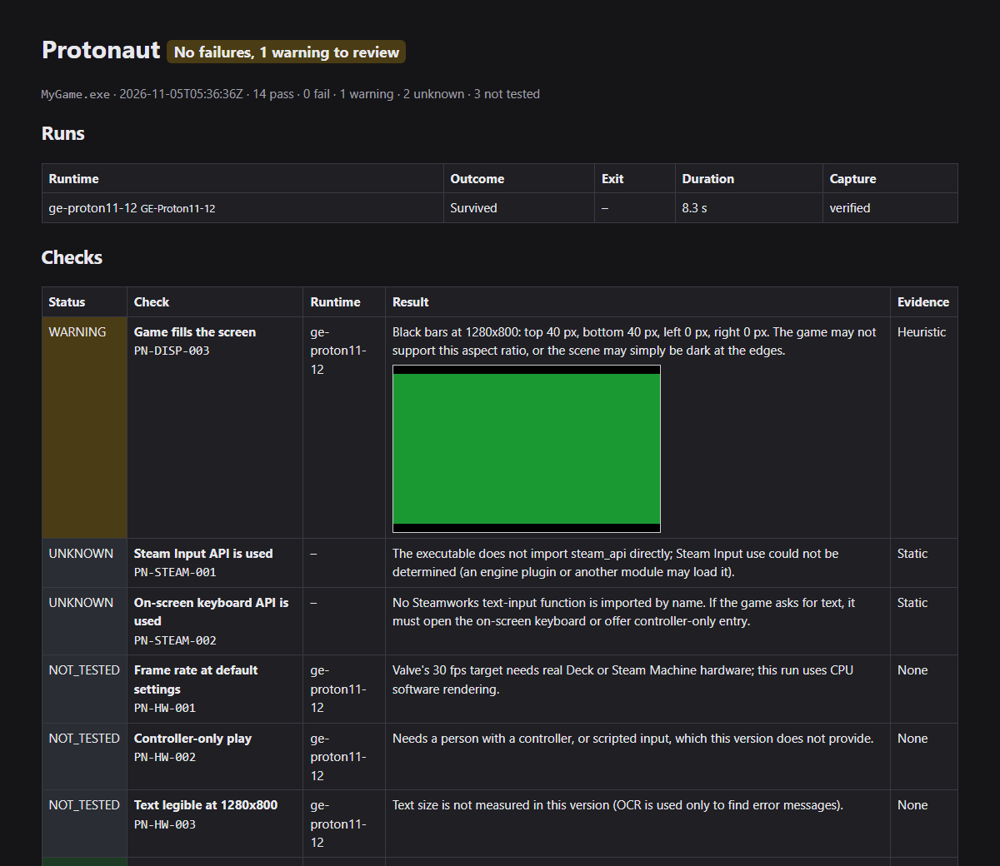

<div align="center">

<picture>
  <source media="(prefers-color-scheme: dark)" srcset="docs/assets/wordmark-dark.png">
  
</picture>

**Go / no-go for your Windows game build on Proton, on every pull request.**

Protonaut runs your build under pinned GE-Proton on a headless Linux display in CI. When a change makes it crash, render black or open the wrong window, the PR goes red with screenshots and logs. You don't need a Steam Deck.

[](https://github.com/Mahan-Imanian/protonaut/actions/workflows/ci.yml)
[](https://github.com/Mahan-Imanian/protonaut/actions/workflows/real-games.yml)
[](https://github.com/Mahan-Imanian/protonaut/releases/latest)
[](#license)

[**Website**](https://mahan-imanian.github.io/protonaut/) ·
[Quick start](#quick-start) ·
[Recipes](docs/recipes.md) ·
[All checks](docs/reference/checks.md) ·
[Changelog](CHANGELOG.md)



</div>

> Independent community project, **not affiliated with Valve**. A pass cannot predict a Steam Deck Verified rating, and software rendering does not test GPU performance or how the game feels on a controller.

## Quick start

Add one step to a GitHub workflow on `ubuntu-24.04`, after your build:

```yaml
- uses: Mahan-Imanian/protonaut@v0
  with:
    build: dist/Windows
    exe: MyGame.exe
```

The step fails on any `FAIL`, writes the report to the job summary, and uploads screenshots and logs as an artifact. Using Godot, Unity or Unreal? Copy a workflow from the [recipes](docs/recipes.md).

To run it on your own Ubuntu 24.04 machine:

```bash
curl -fsSL https://raw.githubusercontent.com/Mahan-Imanian/protonaut/main/install.sh | sh -s -- --with-deps
sudo protonaut setup
protonaut test dist/Windows --exe MyGame.exe --install
```

## Why it exists

Valve's compatibility review happens after you submit a build. It takes about a week and repeats after Proton updates. Until now, catching a regression earlier meant testing by hand on Linux or a Deck.

| | Protonaut | Valve's review | Testing on a Deck |
|---|---|---|---|
| Runs on | Every pull request | After you submit a build | When someone has time |
| Needs hardware | No, a GitHub runner | No | Yes |
| Catches crashes and black screens | Yes | Yes | Yes |
| Tests frame rate and controller feel | No | Yes | Yes |
| Gives you a Verified rating | No | Yes | No |

Protonaut narrows what reaches a person. It does not replace the review or a device.

## What it catches



<sub>From the live [demo pull request](https://github.com/Mahan-Imanian/protonaut-demo/pull/1). The build is one of the project's test programs, not a real game.</sub>

| | Examples |
|---|---|
| **Launch and stability** | crashes (unhandled exceptions), exits with an error, missing DLLs, a game that never opens a window |
| **Rendering** | black or empty frames, letterboxing at 1280x800, extra "unsupported hardware" style windows, error text inside the game window (read with OCR) |
| **The build itself** | 32/64-bit and ARM64 executables, DLL imports nothing provides, files that differ only by case, anti-cheat files, launchers, Media Foundation video |
| **Steamworks hints** | whether the Steam Input and on-screen keyboard APIs are imported |

Each result is `PASS`, `FAIL`, `WARNING`, `UNKNOWN` or `NOT_TESTED`, and says whether it was observed, read from the files, or guessed by a heuristic. Missing evidence is never reported as a pass.

**What it cannot tell you:** frame rate on real hardware, real GPU driver behaviour, controller feel, touch input, suspend and resume, battery use, and anything that needs the Steam client. Those still need a device.

## Proven on real games

Besides synthetic fixtures, CI runs open-source games through the action:

- OpenTTD 15.3 (OpenGL)
- A Godot 4.7.2 3D game exported for Vulkan and for Direct3D 12
- Chocolate Doom 3.0.1 (32-bit, SDL2) with Freedoom

Results and screenshots are in [real-games.md](docs/compatibility/real-games.md). The testing also found a useful failure: OpenTTD without its graphics set keeps running while it shows a fatal error inside its own window. `PN-DISP-005` now reads the screen with OCR and reports text like that as a warning.



## How it works

1. Your build runs under a pinned, checksum-verified [GE-Proton](https://github.com/GloriousEggroll/proton-ge-custom) release with Mesa's software Vulkan driver on a headless Xorg display at 1280x800, 60 Hz.
2. A control program that draws a known colour runs first under the same runtime. If its frame cannot be captured, screenshot checks report `NOT_TESTED` instead of a false black screen.
3. Your game runs for `observe-secs` as an unprivileged user with no network and no CI token. Protonaut records windows, screenshots and the Wine log, then stops every process.
4. Rules turn that evidence into `report.json` (versioned schema), an HTML report, JUnit XML and a PR comment.

More in [docs/architecture.md](docs/architecture.md).

## Security

Game builds are untrusted code. In the action they run as a separate user, in a network namespace with no network by default, with an empty environment, from a copy of the build. Runtime downloads are pinned by SHA-256, and each release binary has a build provenance attestation that the action verifies before running it. The sandbox is a Linux user, not a virtual machine. The [threat model](docs/security/threat-model.md) covers what this does and does not protect against.

On your own machine the game runs as your user, so only run builds you trust.

## FAQ

**Is this Valve's Proton?** No. Protonaut uses GE-Proton, a community build, because Valve's builds need a Steam login. A game can behave differently under Valve's Proton on a Steam Deck. See [runtimes.md](docs/compatibility/runtimes.md).

**Will a pass get me Deck Verified?** No. Valve decides that, and part of its review needs real hardware. Protonaut reports those criteria as `NOT_TESTED`. See [how the checks map to Valve's criteria](docs/roadmap.md).

**Does it work if my game needs Steam running?** Not yet. There is no Steam client in the test, so a game that requires the Steam API to initialise cannot be tested.

**Does it cover Direct3D 9, 10 and 11?** Partly. Direct3D 11 is covered by synthetic fixtures only, and 9 and 10 not at all. No real game proven to render through DXVK is in the suite yet. If your open-source game could fill that gap, please open an issue.

**Can I use it outside GitHub Actions?** Yes. The `protonaut` CLI runs on x86-64 Linux and exits non-zero on failures, and it writes JUnit XML for other CI systems. This project only runs it on GitHub Actions.

## Known limitations

- Under GE-Proton10-34, Chocolate Doom (32-bit) crashes on start, cause not identified, and DXVK frames are not captured on this display, so its screenshot checks are `NOT_TESTED`.
- Rendering uses Mesa lavapipe on the CPU, so there is no real GPU driver behaviour and there are no performance numbers.
- OCR can miss stylised or very small text, so a clean `PN-DISP-005` is not proof that no error appeared.
- x86-64 Linux hosts only.

Version 0.2 is **experimental**. The CLI, report schema and action inputs may change before 1.0, and the [changelog](CHANGELOG.md) lists every change.

## Roadmap

[docs/roadmap.md](docs/roadmap.md) lists what is verified, what is a heuristic, what could still be automated, and what will always need hardware.

## Contributing

`cargo test --workspace` runs without Proton or a Steam Deck. See [CONTRIBUTING.md](CONTRIBUTING.md) and [docs/development.md](docs/development.md). Reports comparing results with a real device are the most useful thing you can send.

## License

Licensed under either of the [Apache License, Version 2.0](LICENSE-APACHE) or the [MIT license](LICENSE-MIT), at your option. Unless you state otherwise, any contribution you submit for inclusion is dual licensed the same way, without additional terms.

GE-Proton, Wine, DXVK and Mesa are separate projects under their own licenses. Protonaut downloads them at test time and does not redistribute them.

Proton and Steam Deck are trademarks of Valve Corporation. Protonaut is an independent project and Valve does not endorse it.
