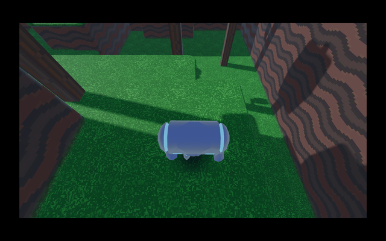

# Real-game validation

Besides the synthetic fixtures, the [Real games](../../.github/workflows/real-games.yml)
workflow runs real open-source games through the GitHub Action on
GitHub-hosted `ubuntu-24.04` runners, every week and on changes to the tool.
Downloads are pinned by SHA-256 or SHA-512. The expectations it asserts were
first checked by hand against the screenshots below.

## Games

| Game | How it is obtained | Rendering path exercised |
|---|---|---|
| OpenTTD 15.3 (GPL-2.0) with OpenGFX 8.0 | Official Windows release and base graphics from cdn.openttd.org | OpenGL through Wine, falling back to OpenTTD's software renderer |
| Godot 4.7.2 3D platformer demo (MIT), Vulkan export | Exported for Windows in CI from the official `godot-demo-projects` repository, pinned commit | Godot Forward+ on Vulkan (winevulkan → lavapipe) |
| The same demo, Direct3D 12 export | As above, with `rendering_device/driver.windows="d3d12"` | Godot Forward+ on Direct3D 12 through vkd3d-proton → lavapipe |
| Chocolate Doom 3.0.1 (GPL-2.0), 32-bit, with the Freedoom: Phase 1 0.13.0 IWAD (BSD-3-Clause) | Official win32 release from chocolate-doom.org (PGP signature checked before pinning) and Freedoom's GitHub release | SDL2's 2D renderer in a 32-bit process; which backend SDL chose (Direct3D 9, Direct3D 11 or OpenGL) is **not identified** |

Godot's own log, written next to the build and read after the run, proves
which renderer ran: `D3D12 11_0 - Forward+ - Using Device #0: … llvmpipe`
for the Direct3D 12 export and `Vulkan 1.4.318 - Forward+ - Using Device #0:
… llvmpipe` for the Vulkan export. Neither fell back.

Chocolate Doom gives no such proof: it does not log its renderer, and
DXVK prints nothing at Proton's default log level. Chocolate Doom is
therefore evidence for 32-bit games in general, not for Direct3D 9.

## What Protonaut reported, and whether it was right

| Aspect | OpenTTD | Godot (both exports) | Report accurate? |
|---|---|---|---|
| Executable launch | Started under both runtimes | Started under both runtimes | Yes |
| Runtime stability | Running after 40 s | Running after 40 s | Yes |
| Window creation | 960x600 window | 1152x648 window | Yes; both reported as windowed, not letterboxed (after a fix found by this test) |
| Rendering | Title screen with real graphics (GE-Proton11-12) | Textured 3D level with shadows and the character (GE-Proton11-12) | Yes. Under GE-Proton10-34 capture does not work, and the screenshot checks were `NOT_TESTED` as designed |
| Asset loading | Base graphics loaded; title savegame shown | Packed resources loaded | Yes for the complete builds; the broken build below is flagged by PN-DISP-005 |
| Imported DLLs | 14, all resolved | 31, all resolved | Yes; OpenTTD's list matches `objdump` exactly |
| In-window error text | "Missing graphics" (build without graphics) | None | Yes, PN-DISP-005 WARNING since 0.1.0 |
| Dialogs | A "Fatal Application Failure" window under GE-Proton10-34 only, flagged by PN-DISP-004 | None | Yes; cause not identified (same Wine log errors under both runtimes) |

Screenshots of every run, including OpenTTD (GPL-2.0 artwork, so not stored
here), are uploaded as artifacts of the Real games workflow.

Chocolate Doom, as reported after the 32-bit fix: under GE-Proton11-12 it
ran for 40 s in a 1280x800 window, the captured frame shows the Freedoom
demo playing, PN-DISP-003 warned about the 4:3 picture's side bars (106 and
107 px, which is correct), and OCR read 312 words of HUD text without an
error hit. Under GE-Proton10-34 it crashed after about 1 s with an access
violation, reported as FAIL; the cause is not identified.

## Problems this testing found

1. **Fixed:** OpenTTD's windowed mode was reported as black letterbox bars.
   PN-DISP-003 now reports a window smaller than the display as such.
2. **Fixed:** on a cold start the capture control could miss DXVK's first
   frame and mark capture as not working. The control is now retried.
3. **Fixed:** OpenTTD **without** its base graphics set shows "Missing
   graphics: OpenTTD requires graphics to function" inside its own window
   and keeps running; it used to be reported as a clean pass. PN-DISP-005
   now reads the screen with OCR and reports it as a WARNING quoting the
   message, and the workflow asserts this on every run.
4. **Fixed:** every 32-bit game failed. Chocolate Doom exited with code 255
   before opening a window because Wine's 32-bit side found no i386 X11,
   FreeType or Vulkan libraries; with those installed SDL then showed
   "Couldn't find matching render driver" (flagged by PN-DISP-004 and
   PN-DISP-005, not passed) until 32-bit OpenGL was added. The action now
   installs these libraries, `diagnose` reports them, a 32-bit fixture runs
   in the end-to-end suite, and the workflow asserts the reviewed result.
5. **Environment-specific:** with software rendering OpenTTD shows "Error
   with video settings... no compatible GPU found". OCR may report it as a
   WARNING; on a Steam Deck with a real GPU the message would most likely
   not appear.

## Not covered by these games

A game proven to render through DXVK (Direct3D 9-11): OpenTTD uses OpenGL,
Godot uses Vulkan or Direct3D 12, and Chocolate Doom's SDL backend is not
identified. Direct3D 11 is covered only by the synthetic fixtures (64-bit and
32-bit); Direct3D 9 and 10 are not covered at all.
Games with Steamworks, anti-cheat or video cutscenes are not covered.
