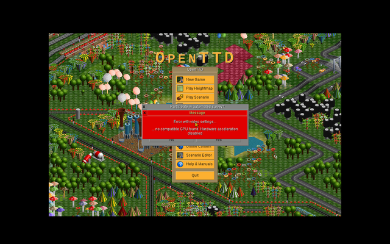
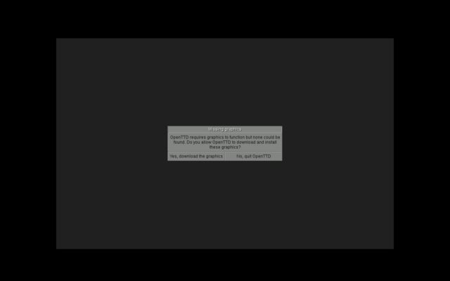

# Real-game validation

Besides the synthetic fixtures, the [Real games](../../.github/workflows/real-games.yml)
workflow runs real open-source games through the GitHub Action on
GitHub-hosted `ubuntu-24.04` runners, every week and on changes to the tool.
Downloads are pinned by SHA-256 or SHA-512. The expectations it asserts were
first checked by hand against the screenshots below.

## Games

| Game | How it is obtained | Rendering path exercised |
|---|---|---|
| OpenTTD 15.3 (GPL-2.0) with OpenGFX 8.0 | Official Windows release and base graphics from cdn.openttd.org | OpenGL through Wine, falling back to OpenTTD's software renderer |
| Godot 4.7.2 3D platformer demo (MIT), Vulkan export | Exported for Windows in CI from the official `godot-demo-projects` repository, pinned commit | Godot Forward+ on Vulkan (winevulkan → lavapipe) |
| The same demo, Direct3D 12 export | As above, with `rendering_device/driver.windows="d3d12"` | Godot Forward+ on Direct3D 12 through vkd3d-proton → lavapipe |

Godot's own log, written next to the build and read after the run, proves
which renderer ran: `D3D12 11_0 - Forward+ - Using Device #0: … llvmpipe`
for the Direct3D 12 export and `Vulkan 1.4.318 - Forward+ - Using Device #0:
… llvmpipe` for the Vulkan export. Neither fell back.

## What SteamOS Preflight reported, and whether it was right

| Aspect | OpenTTD | Godot (both exports) | Report accurate? |
|---|---|---|---|
| Executable launch | Started under both runtimes | Started under both runtimes | Yes |
| Runtime stability | Running after 40 s | Running after 40 s | Yes |
| Window creation | 960x600 window | 1152x648 window | Yes; both reported as windowed, not letterboxed (after a fix found by this test) |
| Rendering | Title screen with real graphics (GE-Proton11-12) | Textured 3D level with shadows and the character (GE-Proton11-12) | Yes. Under GE-Proton10-34 capture does not work, and the screenshot checks were `NOT_TESTED` as designed |
| Asset loading | Base graphics loaded; title savegame shown | Packed resources loaded | Yes for the complete builds; **no** for the broken build below |
| Imported DLLs | 14, all resolved | 31, all resolved | Yes; OpenTTD's list matches `objdump` exactly |
| Dialogs | A "Fatal Application Failure" window under GE-Proton10-34 only, flagged by SP-DISP-004 | None | Yes; cause not identified (same Wine log errors under both runtimes) |

## Problems this testing found

1. **Fixed:** OpenTTD's windowed mode was reported as black letterbox bars.
   SP-DISP-003 now reports a window smaller than the display as such.
2. **Fixed:** on a cold start the capture control could miss DXVK's first
   frame and mark capture as not working. The control is now retried.
3. **Open, documented:** OpenTTD **without** its base graphics set shows
   "Missing graphics: OpenTTD requires graphics to function" inside its own
   window and keeps running. SteamOS Preflight reported this broken build
   as passing. Messages a game draws inside its own window are not read by
   any current check; see [the roadmap](../roadmap.md).
4. **Open, documented:** with software rendering OpenTTD shows "no compatible
   GPU found. Hardware acceleration disabled". Valve's review fails games
   that warn about the GPU, but on a Steam Deck this message would most
   likely not appear, and SteamOS Preflight did not report it either way.

## Not covered by these games

A DXVK (Direct3D 9-11) game engine: OpenTTD uses OpenGL and Godot uses Vulkan
or Direct3D 12. The D3D11 path is covered only by the synthetic fixtures.
Games with Steamworks, anti-cheat or video cutscenes are not covered.
